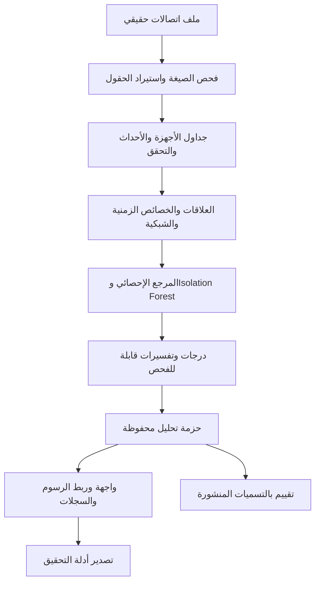

# شرح المشروع والكود

## الفكرة التي تعرضها للدكتور

التطبيق يقرأ سجلات اتصالات شبكة، يحوّلها إلى أحداث وأجهزة، ويحسب خصائص
تصف النشاط والتوقيت والعلاقات. ثم يقارن الأجهزة بمرجع إحصائي وبنموذج
Isolation Forest. تختار جهازاً لتفحص قياساته واتصالاته وتصدر أدلة التحليل.
تسميات المصدر تُستخدم للتقييم بعد حساب الدرجات، ولا تدخل ضمن خصائص النموذج.

البيانات المخصصة للعرض هي ملف CTU-13 الرسمي الكامل، السيناريو 7. فحص المصدر
المستقل أحصى 114,077 تدفقاً و38,204 جهازاً. هذه أعداد من الملف وليست نتائج
كشف محسوبة في MATLAB. لا توجد درجات نموذج جاهزة أو مخزنة يدوياً للعرض.

## ترتيب قراءة الكود

1. `scripts/run_network_demo.m`: نقطة بدء العرض على الملف الرسمي.
2. `src/pipeline/analyzeDataset.m`: الاستيراد وإعداد النطاق ومسارات الحفظ.
3. `src/pipeline/runAnalysisPipeline.m`: ترتيب خطوات التحليل وتجميع النتائج.
4. `src/data/importNetworkFlows.m`: قراءة الاتصال وحقوله وتسمية طرفيه.
5. `src/features/featureRegistry.m`: أسماء القياسات ومعناها وكيفية استخدامها.
6. `src/anomaly/runAnomalyDetection.m`: تشغيل النموذجين على الخصائص نفسها.
7. `src/evaluation/evaluateGroundTruth.m`: مقارنة الدرجات بتسميات المصدر.
8. `app/NetworkBehaviorExplorer.m`: ربط النتائج بالجداول والرسوم والتفاعل.



## شرح الملفات بالتفصيل

- [ملفات البيانات والخصائص والعلاقات والمسار والأدوات](guide/DATA_FILES_AR.md).
- [ملفات النماذج والتقييم والزمن والتسلسلات](guide/EVALUATION_FILES_AR.md).
- [ملفات الواجهة والعرض](guide/UI_FILES_AR.md).
- [السكربتات والإعدادات والاختبارات والوثائق وملفات المستودع](guide/PROJECT_FILES_AR.md).

## الفصل بين بيانات العرض وبيانات الاختبار

ملفات `tests/` تحتوي مدخلات صغيرة معروفة الإجابة لاختبار صحة الخوارزميات.
هي ليست بيانات العرض ولا تُستخدم بديلاً تلقائياً عن ملف المستخدم. الاحتفاظ
بها يسمح باكتشاف أخطاء مثل مضاعفة عد الشركاء أو اختلاف AP عند تعادل الدرجات.

مسار العرض لا يستدعي مولّد fixture ولا يحقن شذوذاً في البيانات الحقيقية.
الحقن المصطنع، إذا طُلب صراحة في تجربة بحثية منفصلة، يبقى موسوماً ومعزولاً
عن التقييم بالتسميات الحقيقية. لا يمكن تحويله إلى دليل على كشف هجمات فعلية.

## ما يجب التمييز بينه أثناء الشرح

- **قيمة مقاسة:** عدد تدفقات أو وجهات أو بايتات مستخرج من السجلات.
- **درجة شذوذ:** مقدار اختلاف إحصائي؛ ليست احتمال إصابة الجهاز.
- **تسمية منشورة:** وصف المصدر الذي نستخدمه لتقييم الترتيب بعد الحساب.
- **حالة غير معروفة:** لا توجد تسمية كافية؛ لا نعني أن الجهاز سليم.
- **غير مؤهل:** تاريخ نشاطه أقل من الحد المحدد؛ لا نختلق له درجة.
- **سجل اتصال داعم:** بيانات يمكنك فحصها، دون ادعاء أنه سبب منفرد لدرجة الجهاز.

## التنفيذ الفعلي

نزّل الملف الرسمي بأداة الاستحواذ المثبتة البصمة، ثم شغّل في MATLAB:

```matlab
run scripts/run_network_demo.m
```

للاحتفاظ بسجلات الاختبارات والتجارب والإعدادات وبصمات الكود:

```matlab
addpath scripts
verify_delivery("data/external/ctu13-scenario7.binetflow")
```

التحقق المحلي المتاح ينفّذ تدقيق المصدر واختبارات Python والفحص الساكن.
تشغيل النسخة الحالية في MATLAB وفحص تفاعل الواجهة لم يُثبت في هذه البيئة.
دليل الملفات يشرح التنفيذ الموجود ولا يغيّر هذه الحقيقة.
